# Guia das análises temporais do MapBiomas

Atualizado em 18/11/2026 · Mario Barroso Ramos Neto (TNC Brasil)

**Nesta página:** [Como as análises funcionam](#funcionamento) · [Qual análise responde à minha pergunta](#perguntas) · [Os quatro pixels de exemplo](#pixels) · [As 10 análises](#dez-analises) · [As outras 6 análises](#outras-analises) · [Cuidados ao interpretar](#cuidados) · [Mapas, áreas e fontes](#fontes)

## Como as análises funcionam {#funcionamento}

As análises temporais do Meu MapBiomas transformam a história de cada pixel, de 1985 a 2025 (Coleção 11), em um único mapa. Cada pixel tem uma classe de cobertura e uso por ano; a análise resume esses 41 anos em um valor: há quanto tempo está numa classe, quantas vezes esteve, quantas classes teve, ou como mudou entre dois anos.

- **Classe de interesse:** quase todas as análises perguntam sobre uma classe que você escolhe, por exemplo Pastagem (15) ou Formação Florestal (3).
- **Pixel transparente:** onde a análise não tem resultado (por exemplo, o pixel nunca foi pastagem), o mapa fica transparente.
- **Resultado é mapa, não área:** para hectares por município, bioma ou propriedade, use as estatísticas da plataforma (última seção).

O Meu MapBiomas oferece 16 análises em "Criar análise". Este guia detalha as 10 temporais, que têm documentação pública, com os nomes como aparecem na tela; as outras 6 estão resumidas numa seção própria. Os exemplos e figuras vêm da [documentação do MapBiomas](https://github.com/mapbiomas/platform-analysis/wiki), que usa a série até 2024; no Meu MapBiomas a série vai até 2025, então valores ligados ao último ano mudam em um ano.

## Qual análise responde à minha pergunta {#perguntas}

Comece pela pergunta; as fichas abaixo detalham cada análise. Os exemplos usam Pastagem como classe de interesse.

| Pergunta | Análise na tela | O valor no mapa |
| --- | --- | --- |
| Há quanto tempo, sem interrupção, esta área é pastagem? | [1. Idade](#idade) | anos seguidos até 2025 |
| Quantos anos, no total, esta área foi pastagem? | [2. Frequência](#frequencia) | anos na classe, seguidos ou não |
| Por quantas classes diferentes esta área passou? | [3. Número de classes](#numero-de-classes) | número de classes |
| Quantas vezes esta área mudou de classe? | [4. Número de mudanças](#numero-de-mudancas) | número de trocas |
| Que áreas nunca mudaram em 41 anos? | [5. Áreas estáveis](#areas-estaveis) | a classe do pixel |
| Quando esta área virou pastagem pela primeira vez? | [6. Primeiro Ano](#primeiro-ano) | ano |
| Quando esta área foi pastagem pela última vez? | [7. Último Ano](#ultimo-ano) | ano |
| Há quanto tempo a pastagem saiu daqui? | [8. Tempo desde a última ocorrência](#tempo-desde-ultima) | anos (0 = ainda é pastagem) |
| Esta área já foi pastagem alguma vez? | [9. Acumulado](#acumulado) | a classe, onde ela já esteve |
| O que era floresta em um ano e virou soja em outro? | [10. Transições](#transicoes) | fluxos de mudança entre dois anos |
| Quanto dura, em média, cada passagem por uma classe? | Intervalo médio | anos (sem documentação pública) |
| Quanto de um tema está dentro de outro (ex.: pastagem em área com fogo)? | Intersecção entre temas | sem documentação pública |
| Como um tema se distribui entre dois territórios? | Intersecção entre territórios | sem documentação pública |
| O que há ao redor de uma área ou infraestrutura? | Análise de entorno | sem documentação pública |
| Quero restringir a análise a alguns subtemas | Máscara | sem documentação pública |
| Que pixels passam de um limiar que eu defino? | Exposição | sem documentação pública |

## Os quatro pixels de exemplo {#pixels}

Todas as fichas usam os mesmos quatro pixels, com Pastagem (15) como classe de interesse. Vale olhar esta figura antes das outras: cada quadradinho é um ano, e o ponto marca os anos de pastagem. As figuras estão em inglês, como na documentação original.

- **A — rotação que volta para pastagem:** floresta até 1992; pastagem 1993–2000; mosaico de usos 2001–2004; pastagem 2005–2008; soja 2009–2013; pastagem de 2014 em diante.
- **B — floresta que nunca mudou:** floresta nos 40 anos.
- **C — pastagem abandonada que voltou a floresta:** floresta até 1990; pastagem 1991–2010; floresta de 2011 em diante.
- **D — floresta convertida em soja:** floresta até 2016; pastagem 2017–2018; soja de 2019 em diante.

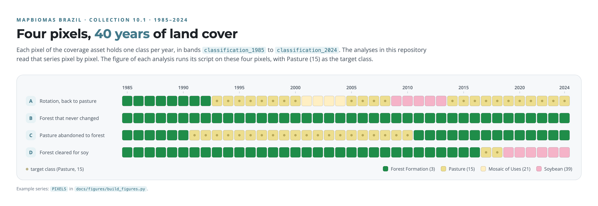

## As 10 análises {#dez-analises}

Cada ficha diz o que a análise mostra, um exemplo com os quatro pixels e o principal cuidado. As cores de cada mapa estão na legenda da camada, na tela. A parte de baixo de cada figura ("How the script computes it") mostra o código usado na documentação e pode ser ignorada.

### 1. Idade {#idade}

**O que mostra:** quantos anos seguidos o pixel está na classe, contando para trás a partir do último ano. Um ano em outra classe zera a contagem. Só tem valor quem está na classe no último ano.

**Exemplo:** o pixel A foi pastagem por 23 anos no total, mas sua idade é 11, porque a soja interrompeu a sequência em 2013. C e D não são pastagem no fim da série e ficam transparentes.

**Cuidado:** idade igual ao tamanho da série quer dizer "desde 1985 ou antes", não "desde 1985".

**A confirmar:** a tela descreve a Idade como "anos decorridos desde a última mudança de classe", o que pode valer para a classe atual de cada pixel, qualquer que seja. A documentação descreve a idade de uma classe escolhida. Verifique se a análise pede uma classe de interesse.

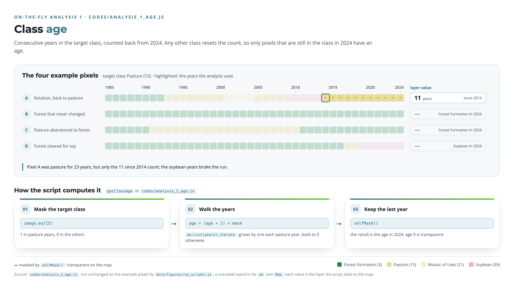

### 2. Frequência {#frequencia}

**O que mostra:** quantos anos, no total, o pixel esteve na classe, seguidos ou não.

**Exemplo:** A tem frequência 23 (em três blocos) e idade 11. C, com 20 anos de pastagem que terminaram em 2010, ainda tem frequência 20.

**Cuidado:** idade baixa com frequência alta indica uma classe que sai e volta, como rotação de culturas ou pastagem que alterna com mosaico de usos.

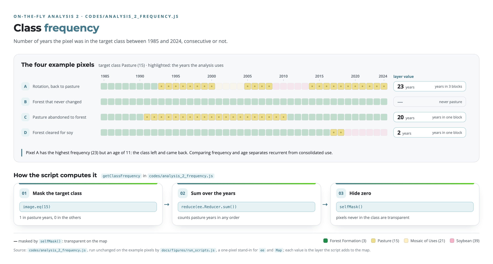

### 3. Número de classes {#numero-de-classes}

**O que mostra:** quantas classes diferentes o pixel teve. Uma classe que aparece em vários períodos conta uma vez. Não depende da classe de interesse.

**Exemplo:** A passou por floresta, pastagem, mosaico de usos e soja: 4 classes. C, que voltou a floresta, tem 2.

**Cuidado:** troca entre classes naturais também conta (veja [Cuidados ao interpretar](#cuidados)).

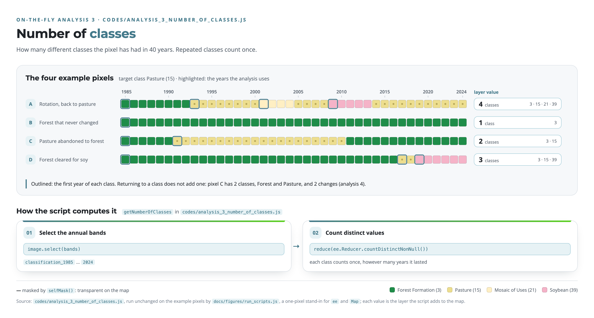

### 4. Número de mudanças {#numero-de-mudancas}

**O que mostra:** quantas vezes o pixel trocou de classe de um ano para o outro. Sair de uma classe e voltar conta duas mudanças. Pixels que nunca mudaram ficam transparentes.

**Exemplo:** C (floresta → pastagem → floresta) tem 2 mudanças e 2 classes. A tem 5 mudanças entre 4 classes.

**Cuidado:** valor alto pode ser dinâmica real ou classificação oscilando entre classes parecidas.

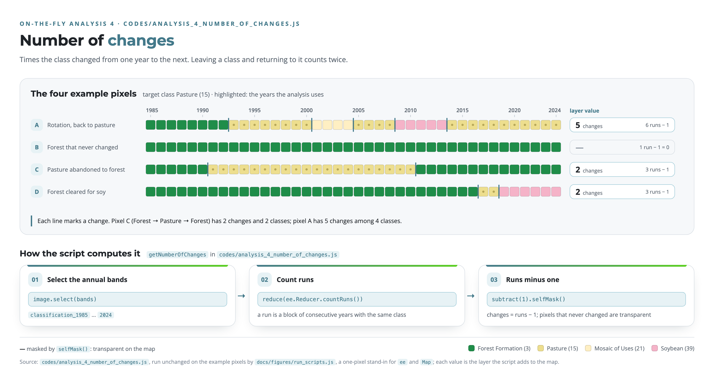

### 5. Áreas estáveis {#areas-estaveis}

**O que mostra:** só os pixels que tiveram a mesma classe em todos os anos, com a cor dessa classe. Todo o resto fica transparente.

**Exemplo:** só o pixel B aparece, como Formação Florestal. D foi floresta por 32 anos, mas dois anos de pastagem o tiram do mapa.

**Cuidado:** é um critério de tudo ou nada. Um único ano classificado diferente, mesmo por erro, exclui o pixel.

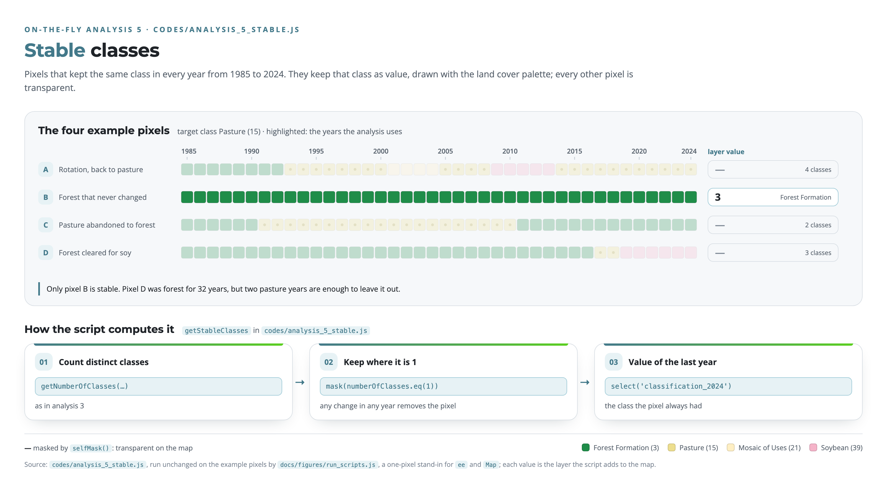

### 6. Primeiro Ano {#primeiro-ano}

**O que mostra:** o primeiro ano em que o pixel aparece na classe.

**Exemplo:** C entrou em pastagem em 1991; D, só em 2017; A, em 1993, com interrupções depois.

**Cuidado:** 1985 quer dizer "já estava na classe no início da série", não "foi convertida em 1985".

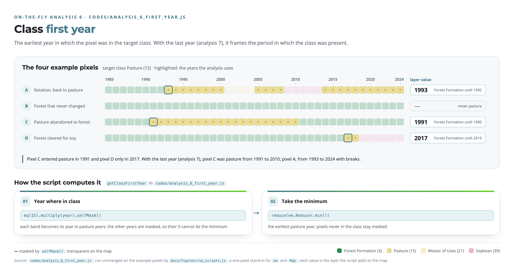

### 7. Último Ano {#ultimo-ano}

**O que mostra:** o último ano em que o pixel aparece na classe. Junto com o primeiro ano, delimita o período em que a classe esteve presente.

**Exemplo:** C deixou a pastagem em 2010 e D em 2018. A ainda é pastagem, então seu valor é o último ano da série.

**Cuidado:** o último ano da série quer dizer "ainda está na classe", não "saiu naquele ano".

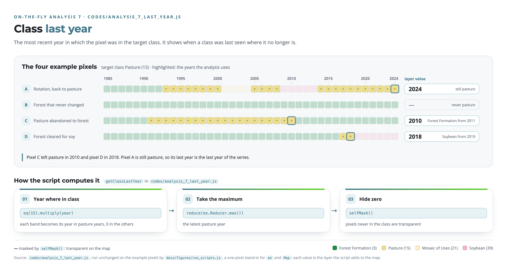

### 8. Tempo desde a última ocorrência {#tempo-desde-ultima}

**O que mostra:** quantos anos se passaram desde a última vez que o pixel esteve na classe. É o último ano expresso como tempo decorrido. Aqui 0 é um resultado e aparece no mapa: o pixel ainda está na classe.

**Exemplo:** C saiu da pastagem há 14 anos e D há 6 (na série até 2024). A vale 0. B nunca foi pastagem e fica transparente.

**Cuidado:** útil para idade de abandono de pastagem, mas a regeneração muito recente pode não aparecer (veja [Cuidados ao interpretar](#cuidados)).

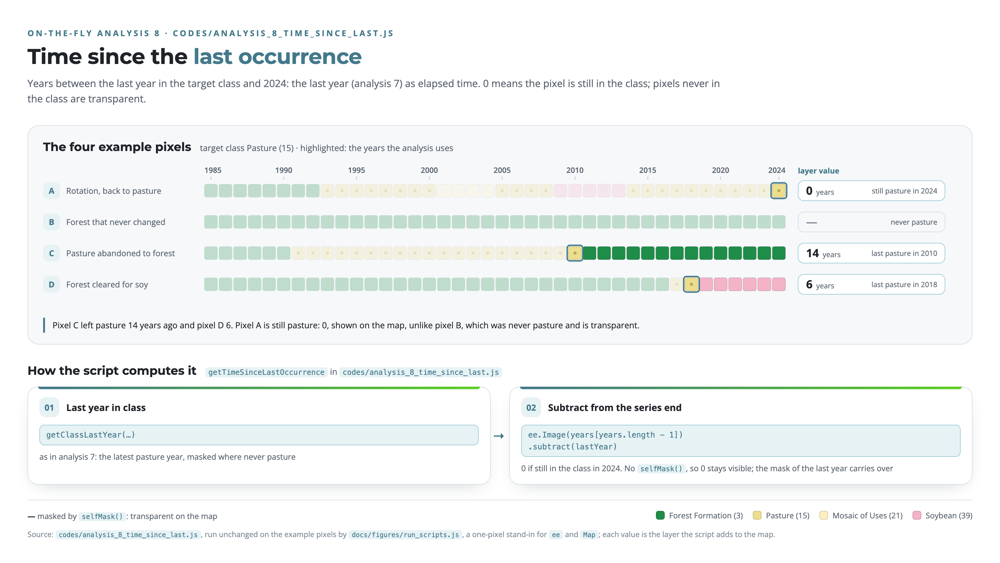

### 9. Acumulado {#acumulado}

**O que mostra:** todos os pixels que estiveram na classe em pelo menos um ano. É a "pegada" histórica da classe, incluindo áreas que já mudaram.

**Exemplo:** A, C e D estão na pegada da pastagem, mesmo D, que foi pastagem por só dois anos e hoje é soja.

**Cuidado:** apesar do nome, não é uma série que se acumula ano a ano. É um único mapa de "já esteve" ou "nunca esteve".

**A confirmar:** a tela fala em "área acumulada da classe ao longo do período", o que sugere uma série ano a ano. A documentação descreve um único mapa de pegada. Verifique se o resultado traz uma série de área por ano ou um mapa.

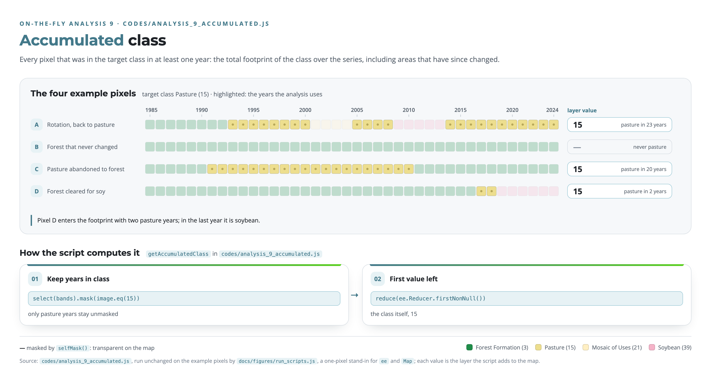

### 10. Transições {#transicoes}

**O que mostra:** compara a classe do pixel em dois anos escolhidos e marca onde ocorreu a transição de interesse, por exemplo floresta em 2008 → soja no ano final, ou pastagem ou mosaico → floresta.

**Exemplo:** D aparece na transição floresta → soja; C, na transição pastagem → floresta. A (pastagem nos dois anos) e B (floresta nos dois) não aparecem.

**Cuidado:** só os dois anos importam; o que aconteceu entre eles não entra.

**A confirmar:** a tela fala em "fluxos de mudança entre as classes analisadas", o que sugere todas as transições de uma vez. A documentação mostra duas transições escolhidas, como exemplo.

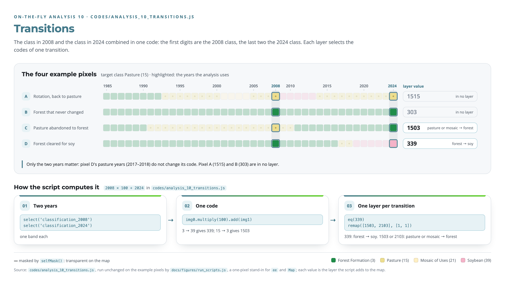

## As outras 6 análises {#outras-analises}

Estas análises ainda não têm documentação pública. O que está abaixo é só a descrição da tela; antes de usar o resultado num relatório, teste numa área que você conhece.

| Análise | Descrição na tela | Tipo |
| --- | --- | --- |
| Intervalo médio | Intervalo médio, em anos, das classes analisadas no período | temporal |
| Intersecção entre temas | Veja a intersecção entre dois temas em um território | cruzamento de dados |
| Intersecção entre territórios | Filtre os dados de um tema entre dois territórios | cruzamento de dados |
| Análise de entorno | Analise o ambiente ao redor de um território ou infraestrutura | espacial |
| Máscara | Recorta a análise pelos subtemas escolhidos | filtro |
| Exposição | Pixels expostos segundo o operador de comparação escolhido | limiar |

Pontos em aberto: em "Intervalo médio", não se sabe se é a duração média de cada passagem pela classe ou o tempo médio entre ocorrências; em "Análise de entorno", qual distância é usada e se pode ser escolhida; em "Exposição", sobre qual valor o operador compara. Este guia será atualizado quando o MapBiomas publicar a documentação.

## Cuidados ao interpretar {#cuidados}

As análises descrevem o que está no mapa, não necessariamente o que aconteceu no campo. Seis pontos evitam as leituras erradas mais comuns.

1. **As pontas da série são cortadas.** O MapBiomas não enxerga antes de 1985 nem depois de 2025. Idade máxima quer dizer "41 anos ou mais"; primeiro ano 1985 quer dizer "já estava lá"; último ano 2025 quer dizer "ainda está".
2. **Mudança de classe não é o mesmo que mudança de uso da terra.** As análises 3, 4 e 5 contam qualquer troca, inclusive entre classes naturais (savana, campo, floresta) e entre lavouras (soja e outras temporárias). No Cerrado, parte dessas trocas é a classificação oscilando na fronteira entre fisionomias. Para medir conversão, prefira uma classe específica nas análises 6–10.
3. **Regeneração curta e recente é removida.** Na Coleção 11, um filtro transforma 1 a 3 anos de vegetação nativa entre períodos de uso em uso. Vegetação secundária jovem tende a ficar de fora ou a aparecer mais tarde.
4. **Transições comparam só dois anos.** Um erro de classificação em qualquer das duas datas vira uma transição falsa, e o que ocorreu no meio não aparece. Para regeneração no Cerrado, inclua Formação Savânica (4) e Campestre (12) como destino, não só Formação Florestal (3).
5. **A série já usa o MapBiomas Alerta.** Vegetação com alerta de desmatamento confirmado é reclassificada como uso. Comparar transições com o Alerta não é uma checagem independente.
6. **Mosaico de Usos (21) é uma classe "não resolvida".** Ele junta pastagem e agricultura que a classificação não separou. Em análises de pastagem, considere se o 21 deve entrar junto.

## Mapas, áreas e onde aprender mais {#fontes}

As análises respondem "onde" e "desde quando"; para "quanto", em hectares, use os módulos de estatísticas da plataforma ou exporte o resultado e calcule a área no seu SIG.

**Fontes**

- [Documentação das análises (wiki do MapBiomas)](https://github.com/mapbiomas/platform-analysis/wiki), com uma página por análise, em inglês.
- [Repositório platform-analysis](https://github.com/mapbiomas/platform-analysis): scripts do Google Earth Engine, para quem quiser reproduzir as análises.
- [Lançamento da Coleção 11 e do Meu MapBiomas](https://brasil.mapbiomas.org/mapbiomas-lanca-colecao-11-de-cobertura-e-uso-da-terra/) (12/08/2026).
- ATBD Geral e apêndice Cerrado da Coleção 11: método, filtros e acurácia (base dos itens 3, 5 e 6 dos cuidados).

---

Figuras: [MapBiomas, repositório platform-analysis](https://github.com/mapbiomas/platform-analysis), usadas com autorização. Texto: TNC Brasil. Dúvidas e correções: Mario Barroso Ramos Neto.
