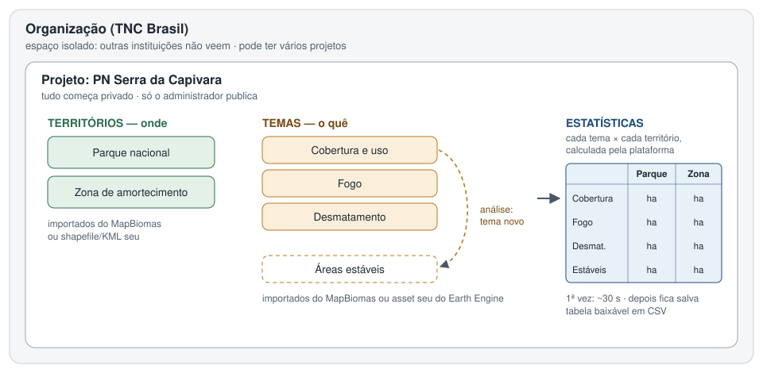

# Primeiros passos no Meu MapBiomas

Atualizado em 19/11/2026 · Mario Barroso Ramos Neto (TNC Brasil) · Baseado no treinamento de 08/10/2026 da equipe do MapBiomas

Este tutorial leva você da primeira senha até um projeto funcionando, com o Parque Nacional da Serra da Capivara como exemplo. Mais do que onde clicar, ele explica **por que** cada passo existe; quem entende a lógica consegue montar o próprio projeto sem seguir receita.

**Nesta página:** [A lógica em uma figura](#logica) · [Passo 1: Acesso](#acesso) · [Passo 2: Organização](#organizacao) · [Passo 3: Identidade do projeto](#identidade) · [Passo 4: Territórios](#territorios) · [Passo 5: Temas](#temas) · [Passo 6: Línguas](#linguas) · [Passo 7: Explorar o projeto](#explorar) · [Passo 8: Criar uma análise](#analise) · [Passo 9: Pessoas e permissões](#permissoes) · [Passo 10: Público e privado](#publico) · [Limitações atuais](#limitacoes)

Para entender o que cada análise calcula, veja o [Guia das análises temporais](./).

> **Sobre as imagens:** os quadros marcados como *[Imagem a inserir]* virão da gravação do treinamento. A interface pode ter mudado desde 08/10/2026; se algo estiver diferente na sua tela, a lógica continua a mesma.

## A lógica em uma figura {#logica}

Tudo no Meu MapBiomas segue quatro ideias:

1. **Organização → projetos.** A sua instituição é uma organização, com um espaço próprio que outras instituições não veem. Dentro dela você cria quantos projetos quiser: um por unidade de conservação, por região ou por programa.
2. **Projeto = territórios × temas.** *Território* é **onde** você quer olhar: o limite de um parque, municípios, propriedades. *Tema* é **o quê** você quer medir: cobertura e uso da terra, fogo, desmatamento, ou um dado seu.
3. **A plataforma cruza tudo sozinha.** Para cada tema em cada território, ela calcula a estatística de área. Você não faz geoprocessamento; você escolhe onde e o quê.
4. **Tudo começa privado.** Nada sai do seu espaço até alguém com perfil de administrador decidir publicar.

As análises (Passo 8) entram nessa lógica como **temas novos**, derivados de um tema que já está no projeto.

## Passo 1: Acesso {#acesso}

**O que fazer:** a pessoa que inscreveu a instituição recebe um e-mail com dois links. Use o primeiro para criar a senha; depois faça login com o mesmo e-mail e essa senha.

**Por que:** essa primeira pessoa é o **administrador** da organização. É ela quem depois convida colegas e define o que cada um pode fazer (Passo 9).

**Cuidado:** use o link de **produção** que veio no e-mail. Quem tinha acesso de testes antigo pode estar num link de demonstração, que não é o mesmo ambiente.

> *[Imagem a inserir — vídeo 4:40: e-mail de boas-vindas e tela de criação de senha]*

## Passo 2: Cadastrar a organização {#organizacao}

**O que fazer:** no primeiro login, um assistente pede o nome da organização, o e-mail de contato, o tipo de organização, uma descrição curta e a **língua de cadastro**.

**Por que:** a organização é o "dono" de todos os projetos. A língua de cadastro é a língua em que vocês vão administrar a plataforma; ela pode mostrar o conteúdo em várias línguas (Passo 6), mas a gestão acontece em uma.

**Cuidado:** escolha a língua em que a equipe trabalha (português, no nosso caso). As traduções vêm depois.

> *[Imagem a inserir — vídeo 5:55: formulário da organização]*

## Passo 3: Identidade do projeto {#identidade}

**O que fazer:** o assistente passa a criar o primeiro projeto. Preencha:

- **Logo** (e, se quiser, uma versão menor e simplificada) e se o nome aparece junto do logo. No exemplo: logo do parque, nome "Parque Nacional Serra da Capivara".
- **Descrição** do projeto.
- **Link** do projeto (opcional).
- **Visualização plana ou em globo.** Use **plana**; o globo serve para projetos de escala global.
- **Cores** dos painéis, das fontes e de realce. A plataforma sugere cores a partir do logo, ou você usa a paleta do MapBiomas.

**Por que:** cada projeto é uma "plataforma" própria, com a cara da área ou do programa. Isso importa quando o projeto for publicado e compartilhado com parceiros. Para um teste, os padrões bastam.

> *[Imagem a inserir — vídeo 7:30: logo, nome e descrição]*
> *[Imagem a inserir — vídeo 8:25: escolha de cores]*

## Passo 4: Territórios — onde você vai olhar {#territorios}

Este é o passo que mais exige atenção, porque os territórios definem **sobre o que** todas as estatísticas serão calculadas.

**Duas formas de trazer um território:**

- **Importar do MapBiomas:** escolha numa lista de limites prontos: Brasil, regiões, estados, municípios, biomas, bacias hidrográficas, Lei da Mata Atlântica, setores censitários, terras indígenas e unidades de conservação, entre outros. É o caminho mais simples para um primeiro projeto.
- **Subir um arquivo seu:** um **shapefile compactado em .zip** (com os arquivos .shp, .shx, .dbf e .prj, em qualquer projeção) ou um **KML/KMZ**. No exemplo do vídeo, um único shapefile com dois polígonos: o parque e a zona de amortecimento.

**Ao subir um arquivo, preencha:**

1. **Nome, fonte e ano** do dado (ex.: fonte ICMBio, baixado em 2026). Há também uma etiqueta livre, por exemplo "novo" ou "beta".
2. **Os polígonos se sobrepõem?** Veja o cuidado abaixo.
3. **Campo de nome:** qual coluna da tabela vira o nome de cada polígono. É esse nome que aparece na busca e ao passar o mouse. Dá para compor vários campos, por exemplo nome + estado.
4. **Adicionar território** e depois **publicar**. O território entra como rascunho; ao publicar, a plataforma copia os polígonos para o Google Earth Engine e para o banco de dados. Pode levar alguns minutos, conforme o número de polígonos.

**Por que:** para calcular áreas rápido, a plataforma transforma os polígonos em imagem (raster) no Google Earth Engine. O campo de nome existe porque é o único atributo do arquivo que a plataforma aproveita hoje.

**Cuidados:**

- **Sobreposição.** Se a caixa de sobreposição **não** estiver marcada, todos os polígonos viram uma imagem única e, onde dois se sobrepõem, **só um fica com a área**. Com o CAR, por exemplo, imóveis sobrepostos teriam a área subestimada sem nenhum aviso. **Se houver sobreposição, ou se você não souber, marque a caixa.** Assim cada polígono é calculado separadamente.
- **Não há filtro na importação.** O arquivo sobe inteiro. Se você quer só uma UC de um shapefile com todas, recorte no seu SIG antes.
- **Só o nome é aproveitado.** As outras colunas do arquivo não vão para a plataforma.

> *[Imagem a inserir — vídeo 9:25: lista de territórios do MapBiomas]*
> *[Imagem a inserir — vídeo 11:30: caixa de sobreposição e campo de nome]*
> *[Imagem a inserir — vídeo 13:10: território em rascunho e botão de publicar]*

## Passo 5: Temas — o que você vai medir {#temas}

**O que fazer:** escolha os temas do projeto. Também aqui há dois caminhos:

- **Importar do MapBiomas.** No exemplo: cobertura e uso da terra (30 m, 41 anos), fogo (vários produtos, incluindo retorno do fogo e severidade), vegetação secundária (anual e idade) e desmatamento (anual).
- **Trazer um dado seu** a partir de um *asset* do Google Earth Engine (detalhes no [Passo 7](#explorar), em "Editar o projeto").

**Por que:** cada tema escolhido será cruzado com cada território do Passo 4. Ao importar cobertura, fogo e desmatamento, você já tem, para o parque e para a zona de amortecimento, a história de uso, o fogo e a perda de vegetação, sem processar nada.

**Cuidado:** tudo que você importa entra marcado como **privado** (um símbolo aparece ao lado). Isso é intencional; veja o [Passo 10](#publico). À direita da tela, o mapa vai mostrando o que você já adicionou: confira ali se o território apareceu no lugar certo.

> *[Imagem a inserir — vídeo 14:20: seleção de temas do MapBiomas]*
> *[Imagem a inserir — vídeo 15:30: símbolo de privado e mapa de conferência]*

## Passo 6: Línguas {#linguas}

**O que fazer:** escolha as línguas do projeto. Português é o padrão e o inglês já vem incluído. Clique em **traduzir os campos faltantes** para que a tradução automática preencha o que você escreveu em português. Depois, **concluir** e **ver projeto**.

**Por que:** o projeto pode ser usado por parceiros de outros países. A tradução roda em segundo plano e pode ser revista a qualquer momento.

> *[Imagem a inserir — vídeo 16:15: tela de línguas e tradução automática]*

## Passo 7: Explorar o projeto {#explorar}

O projeto abre já com o zoom no território. Aqui você vê a lógica funcionando.

**Estatísticas calculadas na hora:** ao selecionar um território e um tema, a plataforma calcula a estatística de área. Na primeira vez pode levar uns 30 segundos; depois o resultado fica salvo (em *cache*) e abre na hora. Você pode selecionar só o parque, só a zona de amortecimento, ou os dois.

**Ferramentas:**

- **Tabela de estatísticas**, que pode ser baixada em CSV.
- **Clique num ponto do mapa** para ver o histórico daquele pixel ano a ano. No exemplo, uma área que já foi lavoura e hoje é pastagem.
- **Visualização em 3D.**
- **GIF animado** dos 41 anos de uma área selecionada.

**Cuidado com o cache:** se você usa um dado seu e atualiza o *asset* no Google Earth Engine, **o mapa muda, mas a estatística salva não**. Hoje não há botão para recalcular; avise a equipe do MapBiomas se precisar.

> *[Imagem a inserir — vídeo 17:40: estatística do parque e da zona de amortecimento]*
> *[Imagem a inserir — vídeo 19:20: histórico do pixel ao clicar no mapa]*

### Editar o projeto

Depois de criado, o projeto pode ser editado a qualquer momento pelo painel. Todas as etapas do assistente continuam disponíveis, e há outras:

- **Mapa base:** o fundo do mapa (claro ou escuro). Você pode conectar outros serviços de mapa de fundo, como mosaicos de imagens de satélite, desde que tenham um endereço de serviço web (XYZ).
- **Novos territórios**, do mesmo jeito do Passo 4. No exemplo: o plano de manejo do parque, com as zonas de preservação e de turismo.
- **Novos temas a partir de um asset seu do Google Earth Engine.** O *asset* precisa estar **público** (a plataforma lê com uma conta de serviço; o acesso a assets privados estava prometido para depois de 22/10/2026 — confira se já está disponível). A plataforma reconhece os valores e as bandas, e você monta a **legenda**: intervalos iguais, quantis ou escala logarítmica, ou classe a classe, com cor, nome e agrupamento. Para muitos valores, baixe o **modelo de legenda em CSV**, preencha (valor, classe-mãe, nome, cor) e importe. O dado pode ser anual ou constante (uma única imagem, como solos ou geologia); dados mensais estavam em preparação.

> *[Imagem a inserir — vídeo 21:15: painel de edição do projeto]*
> *[Imagem a inserir — vídeo 23:30: editor de legenda]*

## Passo 8: Criar uma análise {#analise}

**O que fazer:** na edição dos temas, abra **Criar análise**, selecione o tipo de análise, escolha o tema de origem (por exemplo, a cobertura do MapBiomas) e confirme. No exemplo: **Áreas estáveis** sobre a cobertura.

**Por que:** a análise **cria um tema novo** no projeto, ao lado do tema de origem. No exemplo, a nova camada mostra só as áreas que nunca mudaram de classe; as que ficam de fora tiveram alguma mudança, como uma pastagem que voltou a ser savana. Por ser um tema, ele deve também ser cruzado com os territórios; o treinamento não chegou a mostrar a tabela de uma análise, então confira no seu projeto.

**Para escolher a análise certa,** use o [Guia das análises temporais](./): ele diz que pergunta cada uma das 16 responde e como interpretar o resultado.

> *[Imagem a inserir — vídeo 26:10: escolha do tipo de análise]*
> *[Imagem a inserir — vídeo 26:45: cobertura e áreas estáveis lado a lado]*

## Passo 9: Pessoas e permissões {#permissoes}

**O que fazer:** convide colegas pelo nome e e-mail e escolha o perfil de cada um. As permissões têm dois níveis:

| Nível | Perfis | O que permite |
| --- | --- | --- |
| Organização | Leitura | Ver o que tiver acesso |
| | Edição | Criar e editar projetos |
| | Administração | Tudo, inclusive gerenciar usuários e publicar |
| Cada projeto | Não vê / Lê / Edita | Acesso àquele projeto específico, independentemente do perfil geral |

**Por que:** isso permite, por exemplo, dar a um parceiro acesso de edição a um único projeto sem que ele veja os demais. O convidado não precisa ser da sua instituição.

**Cuidado:** **só quem é administrador publica**. Quem edita mexe no conteúdo, mas não torna nada público.

> *[Imagem a inserir — vídeo 27:40: convite de usuário e perfis]*

## Passo 10: Público e privado {#publico}

**O que fazer:** cada item tem um estado, **público, privado ou inativo**, e o controle é item a item: cada território, cada tema, cada camada e até cada legenda. Um projeto publicado ganha um link (com o nome da instituição e o código do projeto) que pode ser compartilhado ou incorporado ao site da instituição.

**Por que:** a regra "tudo começa privado" dá liberdade para testar. Você pode, por exemplo, manter uma legenda de teste privada e publicar só a versão final.

**Cuidado:** um projeto sem nada público abre vazio para quem não está logado. A equipe do MapBiomas prometeu um treinamento específico sobre publicação.

> *[Imagem a inserir — vídeo 29:00: controle de público, privado e inativo por item]*

## Limitações atuais (novembro de 2026) {#limitacoes}

A plataforma está em fase de testes, e a equipe do MapBiomas pede que os problemas sejam reportados.

- **Pontos não são suportados.** O cálculo foi feito para áreas; contar pontos por território é uma demanda em discussão.
- **Projetos não se juntam.** Para analisar dados de vários projetos juntos, hoje é preciso reunir os arquivos e subir num projeto novo.
- **Territórios muito grandes ou com muitos polígonos** deixam a estatística lenta e podem falhar. Não há limite fixo de área.
- **Onde ficam os dados:** no Google Cloud, na região central dos Estados Unidos, num espaço isolado por instituição. Os novos termos de uso, que descrevem armazenamento e segurança, estavam previstos para novembro de 2026.
- **Custo:** sem custo para as instituições participantes na fase de testes; ONGs e universidades continuariam sem custo.

**Onde reportar:** pelo botão de *feedback* dentro da plataforma (título, descrição e captura de tela) ou pelo formulário divulgado pela equipe do MapBiomas.

---

Fonte: treinamento "Meu MapBiomas", 08/10/2026, equipe do MapBiomas. Tutorial: TNC Brasil. Dúvidas e correções: Mario Barroso Ramos Neto.
